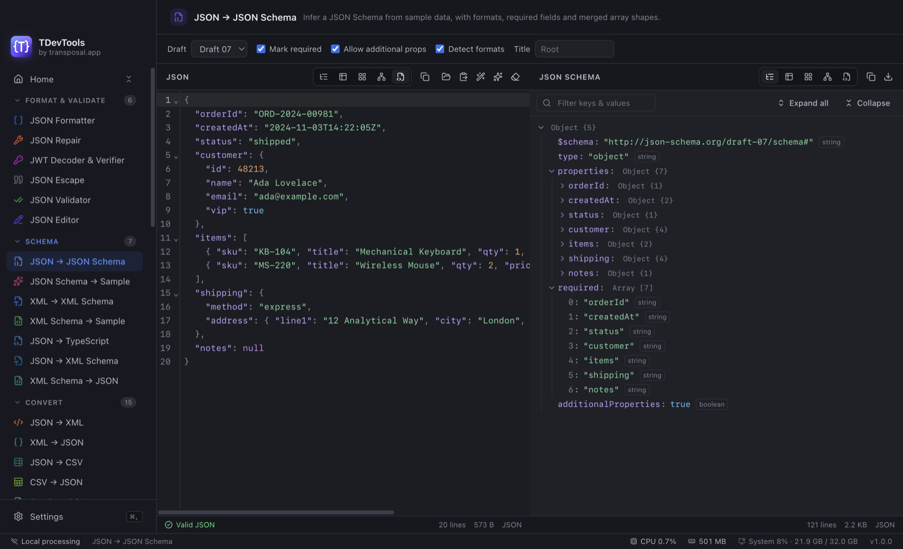
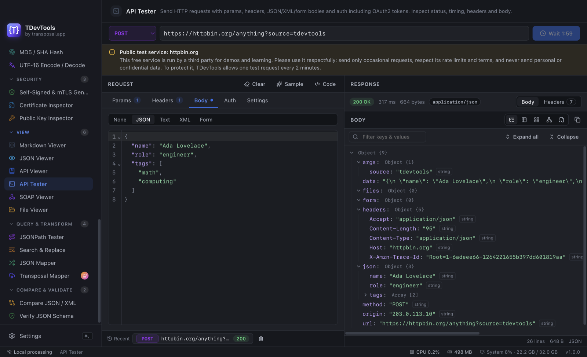
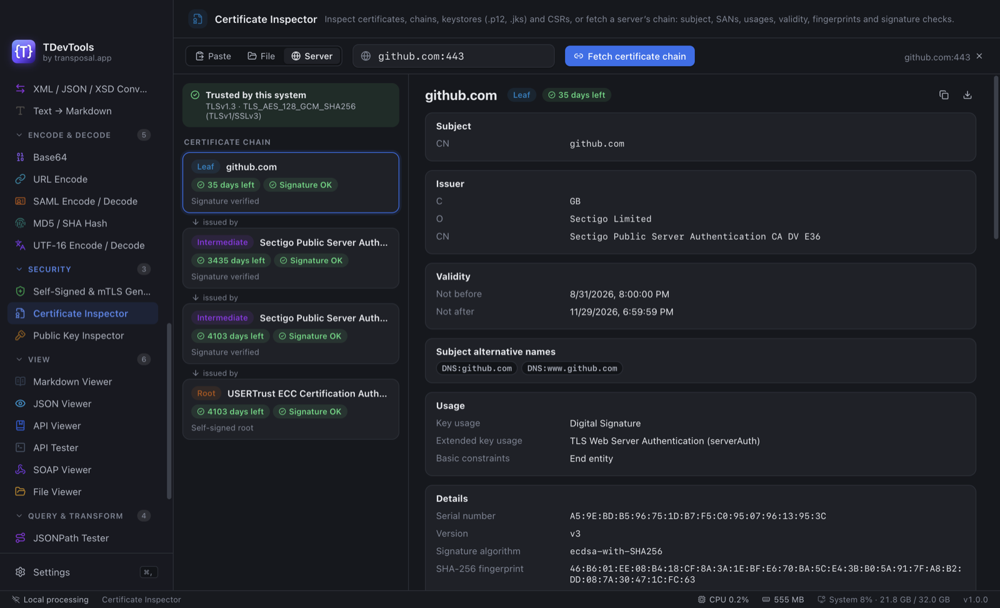

# TDevTools

**A free desktop toolkit for developers: 47 tools for JSON, XML, schemas, APIs, encoding and certificates, for macOS, Windows and Linux.**

By [transposal.app](https://transposal.app)

**Read this in:** [English](README.md) · [Español](README.es.md) · [Français](README.fr.md) · [Deutsch](README.de.md) · [Türkçe](README.tr.md) · [日本語](README.ja.md) · [简体中文](README.zh-CN.md) · [हिन्दी](README.hi.md)

> **🔒 Runs locally. Your data never leaves your computer.**
> TDevTools processes everything **on your own machine**. Your JSON, XML, files, tokens, keys and certificates are **never uploaded**, stored on a server or sent to analytics. There is no account and no tracking.
> The app connects to the internet only when **you** ask it to: when you load a URL, send a test request to your API, or fetch a server's certificate. All other tools work fully offline.

## Screenshots

**JSON → JSON Schema**: infer a schema from sample data, with the full tool list in the sidebar.



**API Tester**: send requests and inspect the response as a tree, table or raw text.



**Certificate Inspector**: fetch a server's certificate chain and check every certificate and signature.



---

## Download

Get the latest version from the **[Releases page](https://github.com/siddiquin/TDevTools-releases/releases/latest)**.

| System | File to download |
| --- | --- |
| **macOS**, Apple Silicon (M1–M4) | `TDevTools-<version>-arm64.dmg` |
| **macOS**, Intel | `TDevTools-<version>-x64.dmg` |
| **Windows** 10 / 11, 64-bit (most PCs) | `TDevTools-Setup-<version>-x64.exe` |
| **Windows** 10 / 11, ARM (e.g. Surface Pro X, Snapdragon laptops) | `TDevTools-Setup-<version>-arm64.exe` |
| **Windows**, no installation (portable) | `TDevTools-Portable-<version>.exe` |
| **Linux**, 64-bit (x86_64) | `TDevTools-<version>-x86_64.AppImage` |
| **Linux**, ARM64 | `TDevTools-<version>-arm64.AppImage` |

Not sure which Mac you have? Open the Apple menu → **About This Mac**. "Chip: Apple M…" means Apple Silicon; "Processor: Intel…" means Intel.

### System requirements

- **macOS** 12 Monterey or later
- **Windows** 10 or 11 (64-bit or ARM64)
- **Linux**: a recent 64-bit distribution (Ubuntu 20.04+, Debian 11+, Fedora 36+ or similar)
- About 300 MB of disk space

---

## Installation

### macOS

1. Download the `.dmg` file for your Mac (see the table above).
2. Double-click the `.dmg` to open it, and accept the license agreement.
3. Drag **TDevTools** onto the **Applications** folder.
4. Eject the disk image (click ⏏ next to "TDevTools" in Finder's sidebar).
5. Open TDevTools for the first time using the steps below.

#### Opening TDevTools the first time

TDevTools is not signed with a paid Apple Developer certificate, so the first time you open it macOS shows a warning such as *"Apple could not verify 'TDevTools' is free of malware"* or *"TDevTools can't be opened because it is from an unidentified developer"*. This is expected. You only need to approve the app **once**; after that it opens normally.

##### macOS 14 Sonoma and earlier: right-click → Open

1. Open your **Applications** folder in Finder.
2. **Right-click** (or Control-click) **TDevTools** and choose **Open**.
3. In the warning, click **Open**.

##### macOS 15 Sequoia and later: Privacy & Security → Open Anyway

Apple removed the right-click shortcut in macOS 15, so use System Settings:

1. Double-click **TDevTools** in Applications. When the warning appears, click **Done**.
2. Open **System Settings → Privacy & Security**.
3. Scroll down to the **Security** section. Next to *"TDevTools" was blocked to protect your Mac*, click **Open Anyway**.
4. Enter your password (or use Touch ID), then click **Open Anyway** in the next message.

##### If macOS says "TDevTools is damaged and can't be opened"

This message can appear for apps downloaded from the internet that aren't signed by Apple. It does not mean the file is broken. Move the app to the Trash only if you didn't download it from the official [Releases page](https://github.com/siddiquin/TDevTools-releases/releases/latest). Otherwise, open **Terminal** and run:

```bash
xattr -dr com.apple.quarantine /Applications/TDevTools.app
```

Then open TDevTools normally. The command removes the "downloaded from the internet" flag from TDevTools only.

### Windows

#### Installer (recommended)

1. Download `TDevTools-Setup-<version>-x64.exe`, or the `arm64` file for ARM PCs.
2. Double-click the file.
3. If you see **"Windows protected your PC"** (SmartScreen), click **More info**, then **Run anyway**.
4. Accept the license agreement, choose the install folder (or keep the default), and click **Install**.
5. Start TDevTools from the **Start menu** or the **desktop shortcut**.

The installer installs for your user account only, so you don't need administrator rights.

#### Portable version (no installation)

1. Download `TDevTools-Portable-<version>.exe`.
2. Put it anywhere, for example on your desktop or a USB stick, and double-click it to run.
3. If SmartScreen appears, click **More info → Run anyway**.

### Linux (AppImage)

An AppImage is a single file that runs on most distributions without installation.

1. Download `TDevTools-<version>-x86_64.AppImage`, or `arm64` for ARM machines.
2. Make it executable. Either:
   - right-click the file → **Properties → Permissions** → tick **Allow executing file as program**, or
   - run this in a terminal:

     ```bash
     chmod +x TDevTools-*.AppImage
     ```

3. Double-click it, or run `./TDevTools-<version>-x86_64.AppImage`.

**If it doesn't start:** some distributions (for example Ubuntu 22.04 and later) need the FUSE 2 library:

```bash
# Ubuntu / Debian
sudo apt install libfuse2      # on Ubuntu 24.04: sudo apt install libfuse2t64
# Fedora
sudo dnf install fuse-libs
```

**Optional: add it to your application menu.** Move the AppImage to `~/Applications`, then use a tool such as [Gear Lever](https://flathub.org/apps/it.mijorus.gearlever) or AppImageLauncher, which create the menu entry and icon for you.

---

## Updating

Download the new version from the [Releases page](https://github.com/siddiquin/TDevTools-releases/releases/latest) and install it the same way. Your settings are kept.

- **macOS:** drag the new version into Applications and choose **Replace**.
- **Windows:** run the new installer; it updates the existing installation.
- **Linux:** replace the old AppImage file with the new one.

## Uninstalling

- **macOS:** drag **TDevTools** from Applications to the Trash. To also remove your settings, delete `~/Library/Application Support/TDevTools`.
- **Windows:** **Settings → Apps → Installed apps → TDevTools → Uninstall**. To also remove your settings, delete `%APPDATA%\TDevTools`. For the portable version, just delete the `.exe`.
- **Linux:** delete the AppImage file. To also remove your settings, delete `~/.config/TDevTools`.

TDevTools stores only your preferences (theme, language and similar). It never keeps copies of your data, passwords or keys.

---

## Features

### Format & Validate

- **JSON Formatter**: beautify or minify, sort keys, with exact line and column errors.
- **JSON Validator**: pinpoints syntax errors with a caret and flags duplicate keys.
- **JSON Repair**: fixes comments, trailing commas, single quotes, unquoted keys and Python/JS literals, and lists every change.
- **JSON Editor**: visual tree and table editing with undo.
- **JWT Decoder & Verifier**: readable claims and expiry, signature verification (HS/RS/PS/ES/EdDSA) and token signing.
- **JSON Escape / Unescape**.

### Schema

- JSON → JSON Schema · JSON Schema → sample JSON
- XML → XML Schema (XSD) · XSD → sample XML
- JSON → TypeScript · JSON → XSD · XSD → JSON

### Convert

- JSON ⇄ XML, and a three-way **XML / JSON / XSD** live converter
- JSON ⇄ CSV · Excel (.xlsx, .xls, .ods) ⇄ JSON
- JSON ⇄ YAML · JSON ⇄ TOON (compact format for LLM prompts) · JSONL ⇄ JSON
- JSON → Markdown · Text, HTML or rich text → Markdown

### Encode & Decode

- Base64 · URL encode/decode
- **SAML** request/response decode and encode, with a readable summary
- MD5 / SHA-1 / SHA-256 hashes
- UTF-16 encode/decode with a per-character table

### Security: local HTTPS and mTLS testing

- **Self-Signed & mTLS Generator**: creates a self-signed certificate, or a complete local mTLS kit (your own CA, a server certificate and a client certificate).
  - You get PEM files, PKCS#12 (.p12) bundles and a Java truststore.
  - Step-by-step setup for curl, Node.js, Spring Boot, nginx, Java keytool, and trusting the CA on macOS and Windows.
- **Certificate Inspector**: open PEM, DER, PKCS#7, .p12/.pfx, JKS keystores and CSRs, or fetch any server's certificate chain.
  - See the full chain with signature checks, every certificate field and extension, fingerprints and expiry warnings.
- **Public Key Inspector**: RSA, EC and Ed25519 keys from PEM, OpenSSH or JWK.
  - Shows key size, curve and all common fingerprints, and converts between formats.

### View

- **JSON Viewer**: Tree, Table, Grid, Graph and Raw views.
- **API Viewer**: browse OpenAPI 3 / Swagger 2 specs and try every endpoint, with API key, Basic, Bearer and OAuth2 sign-in.
- **API Tester**: a full HTTP client with OAuth2 token flows and client certificates (mTLS).
- **SOAP Viewer**: load a WSDL, browse operations, see request and response envelopes, and send test calls.
- **File Viewer**: open or drop JSON, CSV, Excel, XML, YAML, Markdown, HTML or ZIP files; HTML previews are safely sandboxed.
  - **webMethods `node.ndf` → JSON Schema** for document types and service signatures.
- **Markdown Viewer** with a live preview.

### Query & Transform

- **JSONPath Tester** with live highlighting
- **Search & Replace** with regex support
- **JSON Mapper**: reshape JSON with rules, then export the mapping as JavaScript, TypeScript, Python or C#.
- **Transposal Mapper** (optional premium cloud service): any-to-any transformation between EDI, XML, JSON, CSV, SOAP, fixed-length files and databases.

### Compare & Validate

- **Compare JSON / XML**: side-by-side structural diff.
- **Verify JSON Schema**: line-level errors with one-click fixes and a before/after review.

### Everywhere in the app

- 8 languages: English, Español, Français, Deutsch, Türkçe, 日本語, 简体中文 and हिन्दी
- 6 themes (including Dark, Midnight, Nord and Solarized), accent colors, density and zoom
- Copy buttons on every output, a right-click menu, and drag-and-drop files
- CPU and memory usage in the status bar

---

## Privacy & security

- **Local processing.** Every conversion, validation and inspection happens on your computer. Nothing you paste or open is uploaded.
- **No accounts, no telemetry, no ads.**
- **Network only on request.** The app connects only when you load a URL, send a request, sign in to your own API with OAuth, or fetch a server certificate.
- **Secrets stay in memory.** Passwords, tokens and private keys are kept only while the app is open. Only your preferences are saved.
- **Built safely.**
  - Sandboxed windows and a strict content security policy.
  - HTML previews never run scripts.
  - The app asks before opening any program or script.
  - Login details are never sent to a different server than the one you chose.
- **Public demo services.** The built-in examples call public demo servers. Please use them respectfully; the app limits them to one request every 2 minutes. Your own URLs and files have no limit.

## Frequently asked questions

**Is TDevTools free?**
Yes, TDevTools is free for developers. See the [License Agreement](LICENSE.md).

**Does it work offline?**
Yes. Everything works offline except the features that, by their nature, talk to a server you choose (loading a URL, API and SOAP test calls, fetching a certificate chain).

**Is the source code available?**
TDevTools is closed source. The source code can be requested by email at **<support@transposal.app>** with the subject "TDevTools".

**Why does my computer warn me when I install it?**
TDevTools is a free app and is not signed with a paid Apple or Microsoft developer certificate, so macOS (Gatekeeper) and Windows (SmartScreen) warn the first time you open it. The app is the same either way. Follow the steps under [Installation](#installation): on a Mac, right-click → **Open** (macOS 14 and earlier) or **System Settings → Privacy & Security → Open Anyway** (macOS 15 and later); on Windows, **More info → Run anyway**. Only download TDevTools from the official [Releases page](https://github.com/siddiquin/TDevTools-releases/releases/latest).

## License & support

- [End User License Agreement](LICENSE.md): free to use, provided "as is" without warranty. The full agreement, in 8 languages, is also inside the app under **Help → License Agreement**.
- [Third-party notices](THIRD_PARTY_NOTICES.md)
- Support: **<support@transposal.app>**
- Website: [transposal.app](https://transposal.app)

© 2026 Transposal. All rights reserved.
